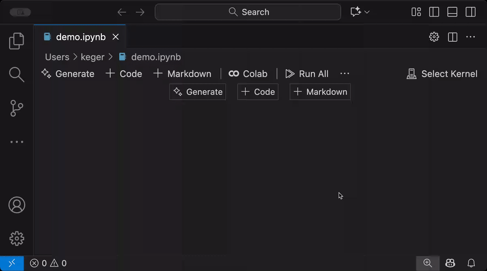

# SimpleDLWorkstation
Repositório para instanciação de Virtual Machine (VM) usando servidores do Google Colab. A ideia deste repositório é simplificar o uso de computação em nuvem integrando um serviço gratuito do Google Colab com a praticidade da IDE do VS Code.

Pré-requisitos:
- [x] **VS Code**
- [x] **Git**
- [x] **Conta Google**
- [x] (Opicional) **ambiente conda/venv**
---

## Alternativa 1: Integração do VS Code com Google Colab para uso de notebooks:
No VS Code, acesse o Quick Open usando o comando `Ctrl+P` e digite:
```bash
ext install Google.colab
```
Crie um notebook.ipynb e selecione o kernel de execução conforme descrito a seguir:



Na opção **'New Colab Server - CPU, GPU, TPU'**, é possível selecionar outros hardwares, como a GPU T4 gratuita. Para finalizar a sessão, basta acessar com `Ctrl+P´ e digitar: `Colab: Remove Server`.

---

## Alternativa 2: Integração do VS Code com Google Colab CLI para uso de scripts python gerais:

### Passo 1: instalação das dependências
```bash
$ conda create -n colab python # opcional
$ conda activate colab # opcional
$ pip install google-colab-cli
```

### Passo 2: instanciação da VM e execução de script python:
```bash
$ colab new -s gpu-t4 --gpu T4 # cria uma sessao de VM com GPU T4
$ colab drivemount -s gpu-t4 # monta o drive na sessao criada (opcional)
$ colab exec -s gpu-t4 -f examples/check_vm.py # roda o script python
$ colab stop -s gpu-t4 # encerra a sessão da VM
```

---

Links úteis:
- https://marketplace.visualstudio.com/items?itemName=Google.colab
- https://github.com/googlecolab/google-colab-cli